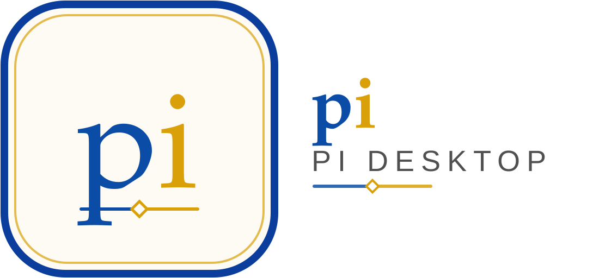

# Pi Desktop



[Website](https://dieuluucanh.github.io/pi-desktop/) ·
[Installation](https://dieuluucanh.github.io/pi-desktop/#installation) ·
[Documentation](https://dieuluucanh.github.io/pi-desktop/docs/) ·
[Release notes](https://dieuluucanh.github.io/pi-desktop/releases/v0.8.1/)

A desktop app for the [Pi coding agent](https://pi.dev) — no terminal, no global
installs. Projects, sessions, chat, providers, models, extensions, packages,
skills, themes and settings are managed through a UI, using the **same
`~/.pi/agent` profile as terminal Pi**, so the two are interchangeable.

> **Status:** v0.8.1 — the fifth public release, a stability patch for the Linux
> packages. v0.8.0 shipped a Linux `node-pty` binary built against glibc 2.42, so
> the integrated terminal could not start on older distributions. v0.8.1 builds it
> in a pinned Debian 11 container, **fails the package** above the support floor
> (glibc 2.31 / `GLIBCXX_3.4.28`), opens a real PTY from the packaged artefacts in
> CI and reports a broken native load instead of dying. The release pipeline also
> retries and caches upstream downloads after the first v0.8.0 tag run failed on
> GitHub 504s. Windows, Linux and macOS installers are built and published from CI
> on a version tag; Windows is the primary artefact, macOS and Linux are beta, and
> builds are unsigned. Known limitations and the deferred backlog are recorded in
> [docs/releases/v0.8.1.md](docs/releases/v0.8.1.md) and
> [docs/product/backlog.md](docs/product/backlog.md).
>
> **Pi for Office is an optional integration.** It installs from Extensions →
> Integrations like any other Pi package, and no Office surface appears unless
> you set it up.

## What it does

- **Projects and sessions** — open a folder, manage recents and trust, and run
  parallel sessions in tabs — or several at once in a pane grid — each in its own
  Pi host process.
- **File explorer and editor** — a project tree with hidden/ignored toggles,
  project-wide name search and drag-to-chat mentions; CodeMirror editor tabs with
  syntax highlighting, conflict-safe saves, hot-exit recovery and Format
  Document.
- **Chat** — streaming text that follows the cursor while pinned (scroll up for
  "Jump to latest"), thinking, one card per tool call with previews, diffs and
  result images, steering/follow-up with pending rows (`Alt+Up` restores them),
  `Esc` to stop, retry/compaction status with cancel, `!`/`!!` shell commands,
  transcript find (`Ctrl+F`), paste markers, `Ctrl+G` expanded editor, Mermaid
  and LaTeX, usage and cost.
- **Integrated terminal** — a real PTY-backed shell in a tab (PowerShell 7,
  Windows PowerShell, cmd, Git Bash and WSL on Windows; `$SHELL` elsewhere), with
  scrollback that survives tab switches, copy-on-selection, shell-key ownership,
  theme-matched colours, terminal settings and a one-off profile menu.
- **Context and commands** — `/` commands (app, extension, prompt, skill), `@`
  files, image paste/drop, `#` Office document mentions, plus `/session`,
  `/copy`, `/import`, `/export jsonl`, `/share`, `/bug`, `/changelog`,
  `/hotkeys` and `/quit`.
- **Providers and models** — OAuth subscriptions, write-only API keys, custom
  gateways, model/thinking pickers, the model scope (shared with Ctrl+Alt cycling
  and extension pickers) and per-project defaults.
- **Extensions and packages** — the same discovery as terminal Pi, with
  provenance, load-error diagnostics, enable/disable, install consent and the
  full `ExtensionUIContext` (dialogs, widgets, status, and the TUI rendering
  surface for `ctx.ui.custom()`).
- **Settings** — every key in Pi’s `docs/settings.md`, global and per project,
  with a raw JSON editor, diff, backups and external-edit detection.
- **Keybindings** — Pi’s `keybindings.json` (including extension shortcuts) plus
  a desktop-only registry with click-to-capture chords, menu accelerators and
  scope-aware conflict warnings.
- **Optional web tabs** — Plannotator and other localhost UIs open in isolated
  in-app tabs.
- **Recovery and safety** — safe mode, crash recovery, a redacted diagnostics
  bundle, sandboxed renderer, strict CSP and an allowlisted IPC surface.

The feature-by-feature comparison with terminal Pi (including the explicit
“MCP = parity, no built-in” note) is
[docs/product/parity.md](docs/product/parity.md).

## Install

Download the installer for your platform from the [website](https://dieuluucanh.github.io/pi-desktop/#installation)
or [GitHub Releases](https://github.com/dieuluucanh/pi-desktop/releases). The Windows NSIS
installer and portable `.exe` are the primary artefacts; macOS `.dmg`/`.zip`
(arm64 + x64) and Linux AppImage/`.deb` (x64 + arm64) are beta. Builds are
unsigned, so SmartScreen/Gatekeeper will warn on first launch (instructions in
the guide, including the macOS approval steps and the Linux FUSE and apt notes).
macOS updates are download-only for now — see the release notes.

Installed release builds check GitHub Releases in the background. When a newer
version exists, the app raises a notification in the bell and marks **About &
updates** in the sidebar; Download and **Restart & install** live in that view.
Locally built packages are stamped `local`, skip automatic checks, and say so
there.

## Develop

```bash
npm ci
npm run runtime:fetch      # bundled Node + npm + shims (~37 MB, not committed)
npm run dev                # Electron + watch builds; renderer dev server on 127.0.0.1:5273
```

Gates (run before every commit; CI runs the same set):

```bash
npm run format:check && npm run typecheck && npm run lint && npm test && npm run build
npm run runtime:verify     # bundled runtime + host bundle (needs runtime:fetch)
npm run office:manifest:check
npm run test:e2e           # Playwright-Electron (needs npm run build)
```

Useful probes: `npm run doctor` (runtime, profile, extensions, bridge, git,
Office) and `npm run office:doctor` (Office detection, sideload, bridge health).

`npm run package:win|mac|linux` fetches the runtime, builds, regenerates the host
shims, runs `runtime:verify` and produces installers under `release/`. Both
arches of each target come from `electron-builder.yml`, not from CLI flags.

## Layout

```text
src/main/            Electron main: window, menu, IPC router, supervisor, updater, Office wiring
src/main/office/     UI-free Office setup backend (detect, install, sideload, verify, wizard)
src/preload/         the only place that touches contextBridge/ipcRenderer
src/renderer/src/    React app: layout/, views/, ui/ primitives, state/ (zustand), styles/
src/host/            the Pi host process (all SDK contact in src/host/sdk/)
src/shared/          types, constants and the single IPC allowlist
packages/checkpoints/  the publishable @dieulc/checkpoints package
resources/           vendored Office manifest, fetched Node/npm runtime
tests/               vitest (node project + jsdom renderer project) and Playwright E2E
site/                the public Astro/Starlight site and docs build (separate lockfile)
docs/                product/parity + backlog, the user guide, releases and the architecture docs
```

## Docs

The same docs are published at
[dieluucanh.github.io/pi-desktop/docs](https://dieuluucanh.github.io/pi-desktop/docs/);
the Markdown in `docs/` remains the source.

- **User guide** — [docs/guide/](docs/guide/) (getting started, projects,
  sessions and tabs, providers, models, extensions and packages, settings,
  skills/themes/keybindings, Office, web tabs, troubleshooting, FAQ).
- **Architecture** — [docs/architecture/](docs/architecture/) (app shell,
  host protocol + RPC mapping, extension UI host + TUI surface, Office
  integration, runtime, pinned versions).
- **Parity** — [docs/product/parity.md](docs/product/parity.md).
- **Release notes** — [docs/releases/v0.8.1.md](docs/releases/v0.8.1.md)
  (install table, known limitations, verification status).
- **Backlog** — [docs/product/backlog.md](docs/product/backlog.md).
- **Contributing** — [CONTRIBUTING.md](CONTRIBUTING.md) and
  [AGENTS.md](AGENTS.md); the executable plan is
  `.pi/plans/2026-09-19-pi-desktop-core-first-rebaseline.md`.

## License

MIT — see [LICENSE](LICENSE) and [THIRD_PARTY_NOTICES.md](THIRD_PARTY_NOTICES.md).
Pi Desktop is an independent client built on the Pi SDK and is not affiliated
with the Pi project.
